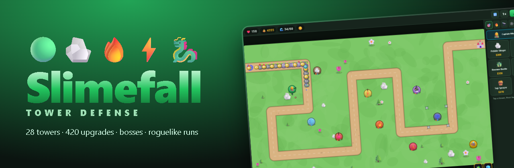
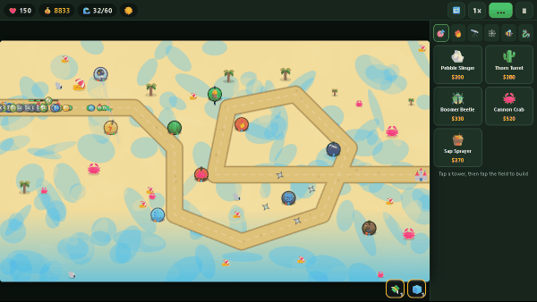
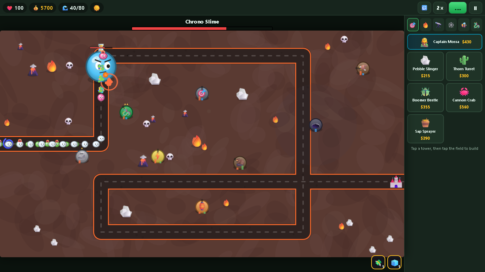
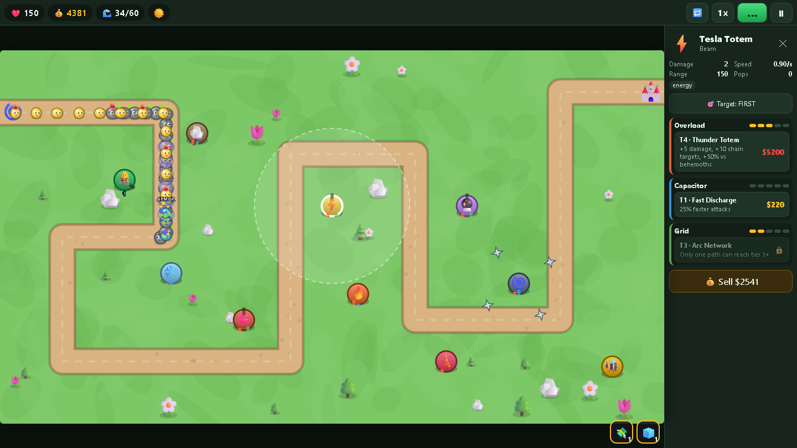
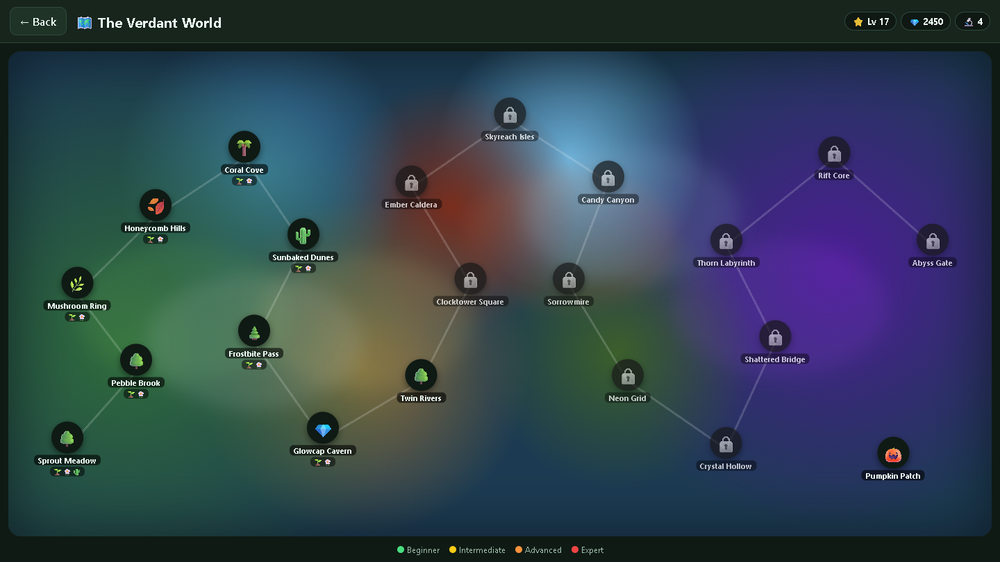
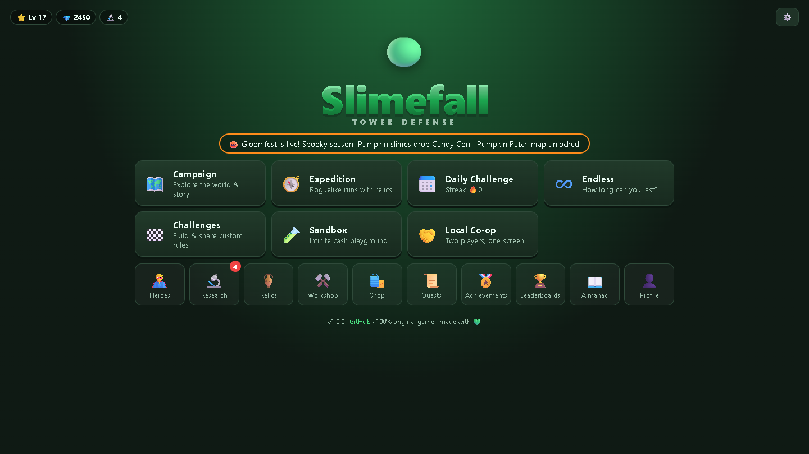
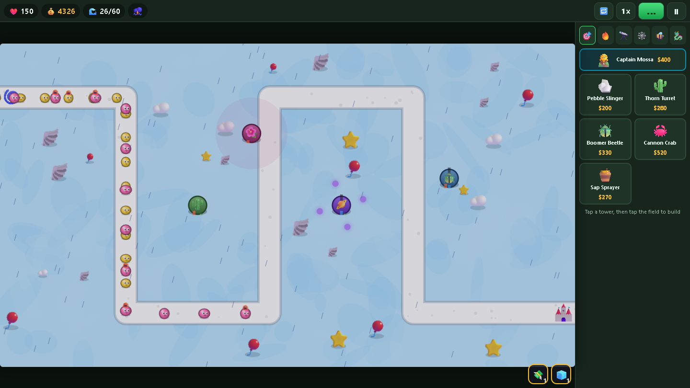
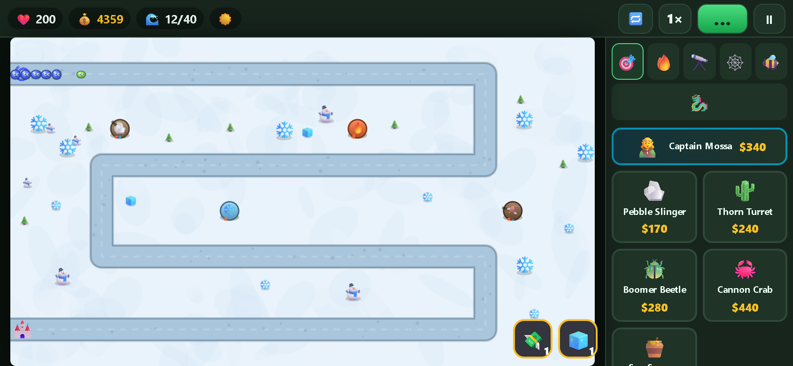
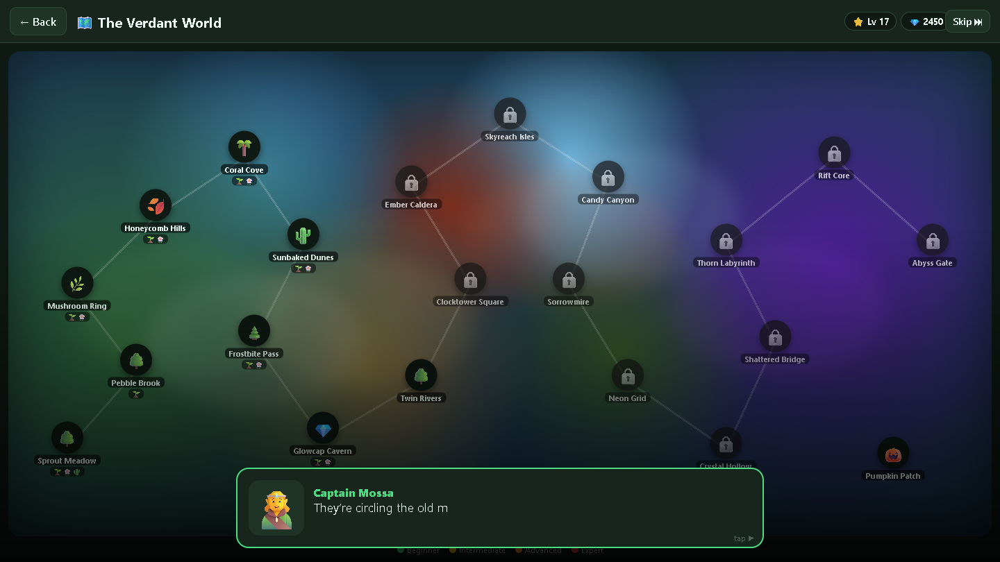
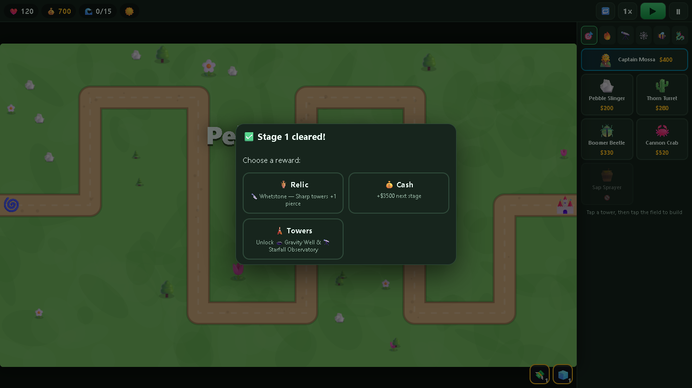

<div align="center">



# 🟢 Slimefall TD

**A free, original tower defense game for Web, Android, iOS, Windows, macOS and Linux.**
Build towers. Raise heroes. Fuse elements. Hold the line against an ocean of slimes.

[](https://jaineil32624.github.io/slimefall-td/play/?music=on)
[](https://jaineil32624.github.io/slimefall-td/play/?music=off)
[](https://jaineil32624.github.io/slimefall-td/)

[](https://github.com/jaineil32624/slimefall-td/releases/latest)
[](https://github.com/jaineil32624/slimefall-td/actions)
[](LICENSE)




</div>

---

## 📲 Install in 10 seconds

| Platform | How | |
|---|---|---|
| 🌐 **Browser** | Just [**click play**](https://jaineil32624.github.io/slimefall-td/play/). No install. | ✅ |
| 📱 **Android / iPhone (as an app, no store)** | Open the game → **⋮ → Install app** (Chrome) or **Share ⬆️ → Add to Home Screen** (Safari). Fullscreen + offline. | ✅ |
| 🤖 **Android APK** | Grab `Slimefall-TD-android.apk` from [**Releases**](https://github.com/jaineil32624/slimefall-td/releases/latest), then tap to install (allow "unknown sources"). | ✅ |
| 🪟 **Windows** | `.exe` installer from [**Releases**](https://github.com/jaineil32624/slimefall-td/releases/latest). | ✅ |
| 🍎 **macOS** | `.dmg` from [**Releases**](https://github.com/jaineil32624/slimefall-td/releases/latest). First launch: right-click → Open. | ✅ |
| 🐧 **Linux** | `.AppImage` from [**Releases**](https://github.com/jaineil32624/slimefall-td/releases/latest). `chmod +x` and run. | ✅ |
| 🏪 **Google Play / App Store** | Build pipeline is ready: see [📖 docs/STORE_RELEASE.md](docs/STORE_RELEASE.md). | 🛠️ |

> 🎵 **Music or no music?** Both! Use the two buttons above, or toggle 🎵 Music / 🔊 SFX anytime in ⚙️ Settings or the ⏸ pause menu.

---

## ✨ Features

<table>
<tr>
<td width="50%" valign="top">

### 🗼 Towers & combat
- **28 unique towers** across 6 classes: 🎯 Primary · 🔥 Elemental · 🔭 Precision · 🕸️ Traps · 🐝 Support · 🐉 Summoners
- **3 upgrade paths × 5 tiers = 420 upgrades**
- 📐 **Triad crosspathing**: up to 7 tiers total, only one path reaches tier 3+ (5‑2‑0, 4‑2‑1, 3‑2‑2…)
- **10 attack styles**: projectiles, beams, chain lightning, line lasers, pulses, auras, traps, orbiting blades, artillery, summons
- ⚡ **Tier‑5 active abilities** (nukes, time‑stop, meteors, cash rush…)
- 🧬 **Tower fusion**: Frost + Ember = ♨️ Steam Geyser, Tesla + Prism = 🌩️ Stormlens (7 recipes)
- ⭐ **Evolution**: towers gain veterancy stars from pops
- 🎯 Targeting: First / Last / Strong / Close

</td>
<td width="50%" valign="top">

### 🟢 Slimes & bosses
- **Layered slimes** that split on pop, with overflow damage
- Damage types & immunities: Splitters shrug off blasts, Frosties ignore ice, Shellbacks laugh at sharp…
- Modifiers: 👻 Phase (needs detection) · ♻️ Regen · 🛡️ Fortified · 💨 Swift · ✨ Shiny
- 🧠 **Smart enemies**: Leapers jump, Menders heal, Disruptors EMP your towers
- 👑 **3 multi‑phase bosses**: 🌿 Hydra Bloom, ⏳ Chrono Slime, 🌌 The Abyss King
- 😈 Elite waves, 🪙 rare Golden Slimes, 🦆 …and a duck

</td>
</tr>
<tr>
<td valign="top">

### 🗺️ Modes
- 🗺️ **World campaign** with story cutscenes across 6 regions
- **22 maps** (Beginner → Expert, multi‑path, secret & seasonal)
- 4 difficulties: 🌱 Sprout · 🌼 Bloom · 🌵 Thorn · 💀 Chaos
- ♾️ **Endless** with infinite scaling
- 🧭 **Expeditions**: roguelike runs with tower drafts, relics & curses
- 📅 **Daily Challenge**: same seed for everyone
- 🏁 **Challenge Editor**: build rules, share via link
- 🧪 **Sandbox** · 🤝 **Local co‑op**

</td>
<td valign="top">

### 📈 Hundreds of hours of progression
- 🦸 **6 heroes** leveling 1→20 mid‑game
- 🔬 **Research tree** (12 permanent upgrades)
- 🏺 **16 relics** with loadout slots
- ⚒️ **Crafting**: slimes drop 🟢💎🔥⭐ resources → powers & relic chests
- 📜 **Daily & weekly quests** · 🏅 **35 achievements**
- 🥇 **Tower mastery** · 🗺️ map medals · ♻️ **Prestige**
- 🎨 Skins & trails · 🎃 **Seasonal events** (live by real date!)
- ⛈️ **Dynamic weather** that changes the rules mid‑game

</td>
</tr>
</table>

### 🎮 Game feel
🎆 pooled particles · 📳 screen shake · 💥 hit flashes · 🎵 **procedural adaptive music** (calm → battle → boss) · 🔊 synthesized SFX · 🕹️ secrets & easter eggs · 📱 touch + 🖱️ mouse + ⌨️ keyboard

---

## 📸 Screenshots

<div align="center">

| 👑 Boss fight | ⬆️ Upgrades |
|---|---|
|  |  |
| 🗺️ **World map** | 🏠 **Title & modes** |
|  |  |
| ⛈️ **Weather** | 📱 **Mobile** |
|  |  |
| 🎬 **Story cutscenes** | 🧭 **Expedition rewards** |
|  |  |

</div>

---

## ⌨️ Controls

| Action | 🖱️ Mouse / 📱 Touch | ⌨️ Keyboard |
|---|---|---|
| Build | Tap tower in shop → tap the field (or drag) | `1`–`9` picks from shop |
| Build several | Shift + click | |
| Select / upgrade | Tap a tower → tap an upgrade | `1` `2` `3` upgrade paths |
| Targeting | 🎯 button | `Tab` |
| Sell | 💰 button | `Del` / `Backspace` |
| Start wave / send next | ▶ | `Space` |
| Speed 1×/2×/3× | ⏩ | `F` |
| Pause / cancel | ⏸ | `Esc` |

---

## 🛠️ For developers

**Zero runtime dependencies.** Plain ES modules + Canvas 2D + WebAudio. No build step: the `www/` folder *is* the game.

```bash
git clone https://github.com/jaineil32624/slimefall-td.git
cd slimefall-td
npm run dev          # 🟢 http://localhost:8080  (no npm install needed!)
npm run sim          # 🤖 headless bot plays 8 games: crash + balance test
```

### 📁 Project structure

```
slimefall-td/
├── www/                     🎮 the game (deployable as-is)
│   ├── index.html · manifest.webmanifest · sw.js (offline PWA)
│   ├── css/style.css
│   └── src/
│       ├── main.js          🚀 app controller, sessions, rewards
│       ├── config.js        ⚙️ global tuning
│       ├── audio.js         🎵 procedural music + SFX
│       ├── save.js          💾 versioned saves, quests, achievements, cloud adapter
│       ├── data/            📊 ALL content & balance (towers, enemies, maps, waves, heroes, meta)
│       ├── game/            🧠 simulation (game.js), renderer, paths, particles
│       └── ui/              🖼️ HUD, menus, DOM helpers
├── site/                    🌐 landing page (GitHub Pages)
├── electron/                💻 desktop shell (Win/Mac/Linux)
├── resources/               🎨 icon + splash for app stores
├── scripts/                 🔧 dev server, site builder, balance simulator
├── docs/                    📖 architecture, balancing, building, store release, backend, roadmap
└── .github/workflows/       🤖 CI · Pages deploy · Android APK/AAB · desktop installers
```

### 🤖 Automated builds (GitHub Actions)

| Workflow | Trigger | Output |
|---|---|---|
| 🧪 `ci.yml` | every push / PR | syntax check + bot plays every difficulty |
| 🌐 `pages.yml` | push to `main` | website at `/` + game at `/play/` |
| 📱 `android.yml` | tag `v*` / manual | `.apk` (+ signed `.apk`/`.aab` for Play Store if secrets set) |
| 💻 `desktop.yml` | tag `v*` / manual | Windows `.exe`, macOS `.dmg`, Linux `.AppImage` |

**Ship a release:** `git tag v1.0.1 && git push --tags` 🚀 and every installer gets attached to the GitHub Release automatically.

### 📖 Docs
- 🏗️ [Architecture](docs/ARCHITECTURE.md): how the engine works
- ⚖️ [Balancing](docs/BALANCING.md): economy, waves, adding towers
- 🔨 [Building](docs/BUILDING.md): Android Studio, Xcode, Electron
- 🏪 [Store release](docs/STORE_RELEASE.md): Google Play & App Store checklist
- ☁️ [Backend](docs/BACKEND.md): cloud saves, online leaderboards, multiplayer plan
- 🗺️ [Roadmap](docs/ROADMAP.md): what's next (guilds, PvP, online co‑op…)

---

## 🗺️ Roadmap

✅ Done in v1.0 · 🛠️ Next up · 💭 Planned (needs a server). See [ROADMAP.md](docs/ROADMAP.md).

✅ 28 towers / 420 upgrades · ✅ heroes · ✅ bosses · ✅ fusion · ✅ weather · ✅ roguelike · ✅ daily · ✅ editor · ✅ sandbox · ✅ local co‑op · ✅ quests · ✅ achievements · ✅ research · ✅ relics · ✅ crafting · ✅ prestige · ✅ seasonal events · ✅ local leaderboards · ✅ save export/import
🛠️ Google Play listing · 🛠️ App Store build · 🛠️ more maps & towers
💭 ☁️ online cloud save · 💭 🌍 global leaderboards · 💭 🤝 online co‑op · 💭 ⚔️ PvP · 💭 🛡️ guilds

---

## 🤝 Contributing

PRs welcome! New tower? New slime? It's mostly **data**: add an entry to `www/src/data/towers.js` and the UI, almanac and upgrade panel pick it up automatically. See [CONTRIBUTING.md](CONTRIBUTING.md).

## 📜 License

[MIT](LICENSE) © 2026 Jaineil Rana. Slimefall is an **original** game: all towers, enemies, maps, art and music are original creations. Inspired by the depth of the tower defense genre; not affiliated with any other game.

<div align="center">

**If you enjoyed it, drop a ⭐. It helps a lot!**

🟢🟢🟢

</div>
